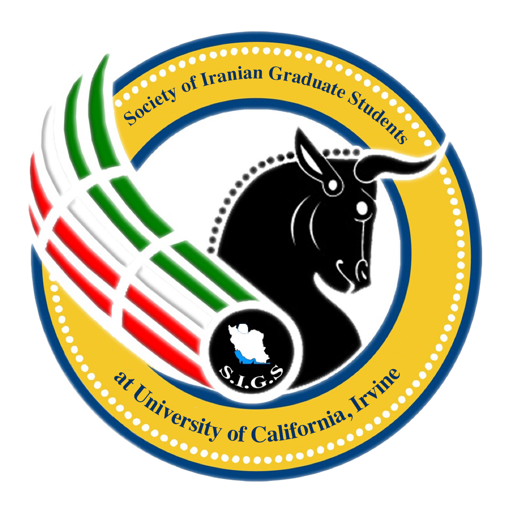

<a href="https://sigs-uci.github.io/en/"></a>

# SIGS at UC Irvine

The website for the Society of Iranian Graduate Students at UC Irvine, in English and Persian. We keep event information, community photographs and videos, campus resources and team contacts in one place.

[English](https://sigs-uci.github.io/en/) · [فارسی](https://sigs-uci.github.io/fa/) · [Event archive](https://sigs-uci.github.io/en/events/archive/) · [Photos and videos](https://sigs-uci.github.io/en/community/memories/) · [Meet the team](https://sigs-uci.github.io/en/about/leadership/) · [Email SIGS](mailto:sigs@uci.edu)

Explore Nowruz and Yalda, film and poetry, newcomer support and professional connections through the archive and program profiles. Memories brings together photographs, historical posters and full-length silent videos. The archive keeps documented gatherings distinct from past announcements.

<div dir="rtl" lang="fa">

<p>برنامه‌ها، آرشیو رویدادها، عکس‌ها و ویدیوها، منابع دانشگاهی و اطلاعات تیم را در <a href="https://sigs-uci.github.io/fa/">نسخهٔ فارسی وب‌سایت</a> ببینید. برای پیشنهاد اصلاح متن یا اطلاعات، به <a href="mailto:sigs@uci.edu" dir="ltr">sigs@uci.edu</a> ایمیل بزنید.</p>

</div>

## Work locally

Use Node.js 24 and the committed npm lockfile:

```sh
npm ci
npm run check
npm test
npm run build
npm run links
npm run output:check
npm run preview
```

Open the local preview address printed by Astro. The preview serves the built site, including search. `npm run dev` starts the editing server; search needs a build first. Run validation locally before committing or publishing. Pushes and pull requests do not run GitHub CI.

Astro and TypeScript build the static site. Pagefind provides separate search indexes for English and Persian. Persian pages use a right-to-left layout and Persian number formatting; both languages share event facts and term-specific contacts.

## Edit and release

Public content lives in `src/data/`. Components and routes read those records. Update the shared facts and review both language versions together.

- [Officer guide](docs/officer-guide.md): routine content, team and media updates.
- [Content templates](docs/content-templates.md): fields and relationships for public records.
- [Architecture](docs/architecture.md): routes, data, search and language handling.
- [Content readiness](docs/content-readiness.md): published material and future additions.
- [Release guide](docs/release.md): local validation and the gated manual Pages release.

Pushing source to `main` and deploying the website are separate actions. Follow the release guide to publish a reviewed commit through **Release website**.

The [organization profile repository](https://github.com/sigs-uci/.github) owns the GitHub organization introduction and shared contributor guidance. Website code and its release workflow belong here.

## Assets and licensing

The SIGS emblem is preserved intact. Fonts are served locally, with the [Manrope](public/fonts/Manrope-OFL.txt) and [Vazirmatn](public/fonts/Vazirmatn-OFL.txt) licenses included. No general software license has been selected for this repository; photograph and video permissions remain separate from software licensing.
